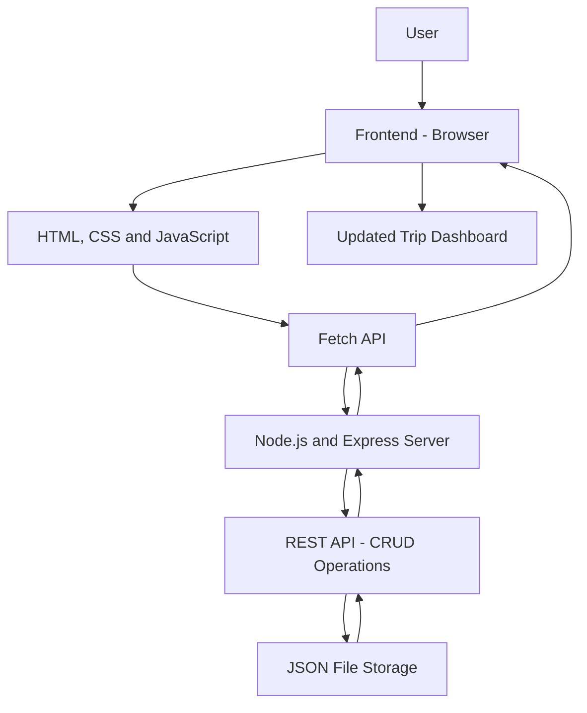
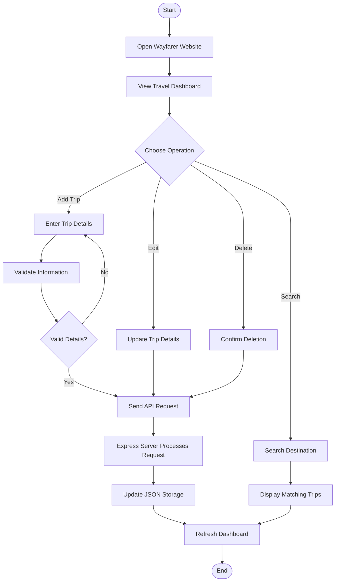

NAME: AADESH SINGH RAJPUT, VIKRAM
UID: 24bcs12622, 24bcs12620
# 🌍 Wayfarer – Full-Stack Travel Planner

**Wayfarer** is a full-stack web-based travel planning application developed using **Node.js, Express.js, HTML, CSS, and JavaScript**. It helps users organize and manage their travel plans in one place.

The application allows users to add, view, update, delete, and search trips. It also displays useful travel statistics, including total planned trips, overall budget, and number of travellers.

## 📌 Project Description

Travel planning often involves managing information across different applications, notes, and spreadsheets. This makes it difficult to organize trips and track expenses.

Wayfarer provides a simple and responsive platform where users can manage all their travel plans through a single dashboard.

### Main Objectives

- Create and manage travel plans.
- Store destination and travel dates.
- Maintain travel budgets.
- Manage the number of travellers.
- Add additional trip notes.
- Search trips by destination.
- Display travel statistics.
- Provide a responsive user interface.

---

## ✨ Features

- **Add Trips:** Create new travel plans with destination, dates, budget, travellers, and notes.
- **View Trips:** Display all saved trips in organized cards.
- **Edit Trips:** Update previously created travel plans.
- **Delete Trips:** Remove trips with confirmation.
- **Search Trips:** Search destinations using a live search feature.
- **Dashboard Statistics:** View total trips, planned budget, and total travellers.
- **Data Validation:** Validate required fields and travel dates.
- **Persistent Storage:** Save trip information in a JSON file.
- **Responsive Design:** Works on desktop and mobile screens.

---

## 🛠️ Technology Stack

| Technology | Purpose |
|---|---|
| HTML5 | Website structure |
| CSS3 | Styling and responsive design |
| JavaScript | Frontend functionality |
| Node.js | Backend runtime environment |
| Express.js | REST API and server management |
| JSON | File-based data storage |
| Fetch API | Communication between frontend and backend |
| Nodemon | Automatic server restart during development |

---

## 🏗️ System Architecture

Wayfarer follows a three-tier client-server architecture.



### Architecture Explanation

1. **Client Tier:** Provides the user interface using HTML, CSS, and JavaScript.
2. **Server Tier:** Node.js and Express.js handle requests and perform CRUD operations.
3. **Data Tier:** A JSON file stores travel information persistently.

---

## 🔄 Project Workflow

The following flowchart explains how the application works when a user manages a trip.



---

## 🔌 REST API Endpoints

The backend provides RESTful API endpoints for managing travel information.

| HTTP Method | Endpoint | Description |
|---|---|---|
| GET | `/api/trips` | Retrieve all trips |
| POST | `/api/trips` | Create a new trip |
| PUT | `/api/trips/:id` | Update an existing trip |
| DELETE | `/api/trips/:id` | Delete a trip |
| GET | `/api/health` | Check server status |

---

## 📂 Project Structure

```text
travel-planner-fullstack/
│
├── data/
│   └── trips.json
│
├── public/
│   ├── index.html
│   ├── styles.css
│   └── app.js
│
├── server.js
├── package.json
├── package-lock.json
├── .gitignore
└── README.md
```

---

## ⚙️ Installation and Setup

Follow these steps to run the project locally.

### Step 1: Clone the Repository

```bash
git clone YOUR_GITHUB_REPOSITORY_LINK
```

### Step 2: Open Project Folder

```bash
cd travel-planner-fullstack
```

### Step 3: Install Dependencies

```bash
npm install
```

### Step 4: Start the Server

```bash
npm start
```

For development mode:

```bash
npm run dev
```

### Step 5: Open in Browser

```text
http://localhost:3000
```

---

## 💾 Data Storage

The application uses a JSON file (`data/trips.json`) for persistent data storage.

Each trip contains:

- Trip ID
- Destination
- Start Date
- End Date
- Budget
- Number of Travellers
- Notes
- Creation Date

The application reads and writes trip information using Node.js file system operations.

---

## 🔒 Validation and Security

- Required fields are validated before saving.
- End date cannot be earlier than the start date.
- Numeric values are normalized.
- User-provided text is rendered using `textContent` to reduce XSS risks.
- Delete operations require confirmation.

---

## 🚀 Future Enhancements

- User registration and login.
- MongoDB or PostgreSQL database integration.
- Google Maps integration.
- Weather information for destinations.
- Day-wise itinerary planning.
- Expense tracking and budget analysis.
- Trip sharing and collaboration.
- Travel reminders and notifications.

---

## 🎯 Conclusion

Wayfarer is a full-stack travel planning application that demonstrates the practical implementation of frontend and backend web development.

The project integrates Node.js and Express.js with a responsive frontend and JSON-based persistent storage. It provides essential trip management functionality through REST APIs and demonstrates CRUD operations, client-server communication, data validation, and responsive web design.

---

## 📚 References

- [Node.js Documentation](https://nodejs.org/docs)
- [Express.js Documentation](https://expressjs.com/)
- [MDN Web Docs](https://developer.mozilla.org/)
- [OWASP XSS Prevention](https://owasp.org/)

---

**Developed as a Full Stack Development College Project**  
**Chandigarh University | Batch 2024–2028**
